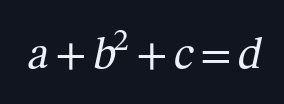
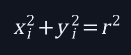
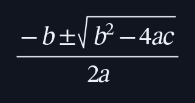
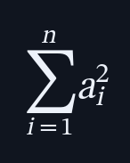
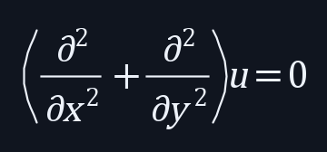
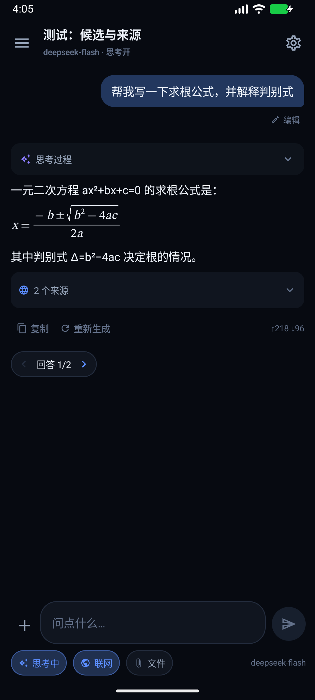
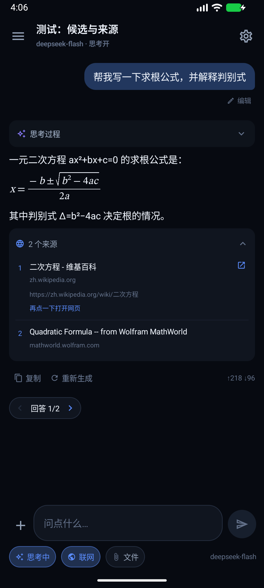
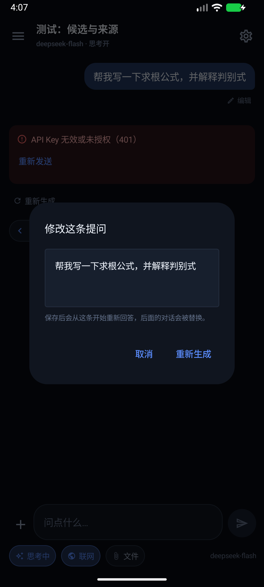
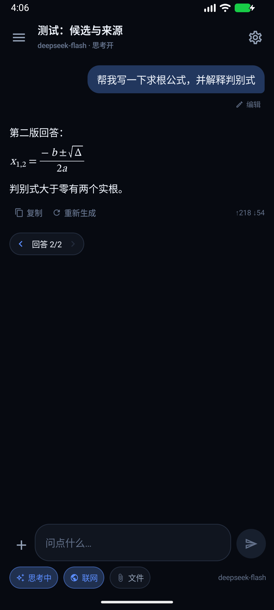

# 深聊 · ShenLiao

> 把 DeepSeek 装进口袋的 Android 客户端：**带自己的 API Key，对话只留在本机**。
> 看图、读文档、联网搜索、思考过程实时可见、LaTeX 公式真排版（内置数学字体），12 MB，没有广告也没有后台服务。


- 包名 `com.shenliao.deepchat` · 当前版本 **1.4**
- 最低 Android 8.0（API 26），编译目标 API 35
- 纯 Kotlin + Jetpack Compose，无 WebView、无第三方 SDK、无统计埋点

---

## 为什么做这个

官方 App 不让你填自己的 Key，网页版又限流；而手上有 API Key 的人，其实只需要一个「壳」：
把它装在手机上，随时随地能问、能拍张照问、能把 PDF 丢进去问，**对话不经过任何中间服务器**。

深聊就是这么一个壳：极简、干净、只做聊天，把 DeepSeek API 的能力尽量完整地接到手机上。
它**不是官方客户端**，也不保存你的任何数据到云端以外的第三方。

## 效果

LaTeX 排版引擎离线渲染的样张（就是 App 里实际用的那套代码）：

| 上标基线对齐 | 上下标混排 | 分式 / 根号 |
| --- | --- | --- |
|  |  |  |

| 求和上下限 | 大括号与偏导 |
| --- | --- |
|  |  |

真机跑起来的样子（Android 模拟器 API 37）：

| 对话：公式 + 来源 | 来源两级展开 | 编辑提问 | 多候选切换 |
| --- | --- | --- | --- |
|  |  |  |  |

## 最近更新

- **1.4.2** 候选回答切换按钮独立成行（◀ 回答 1/2 ▶）；来源改用客户端主动调 Search API 兜底
- **1.4.1** 编辑提问 + 多候选回答（重新生成不再覆盖旧回答）
- **1.4** 联网回答末尾显示来源引用：点一下展开列表，再点一下直接打开网页
- **1.3.1** 内置两款数学字体（STIX Two Math / Latin Modern Math），公式不再用系统黑体渲染，设置里可切换
- **1.3** 修掉公式基线错位：上标盒子把「向上伸出的高度」算进 ascent 却没重新对齐基线，导致 `x²` 里的 `x` 被顶高
- **1.2** 增加联网搜索：声明服务端工具 `deepseek_web_search` / `deepseek_read_url`，搜索与抓取都在服务端执行，客户端不跑任何工具；思考开启时走多步「深度思考搜索」

完整记录见 [CHANGELOG](CHANGELOG.md)。

## 功能

| 能力 | 说明 |
| --- | --- |
| 流式对话 | SSE 逐字出字，随时可停、可复制、可重试 |
| 联网搜索 | 服务端工具 `deepseek_web_search`，模型自己决定搜不搜，回答带引用来源；可在设置单独关闭 |
| 阅读链接 | 服务端工具 `deepseek_read_url`，消息里贴网址时模型自己去读；与联网搜索分开关 |
| 来源引用 | 回答末尾「N 个来源」：点一下展开，再点一下用浏览器打开原网页 |
| 编辑提问 | 自己发的消息可改，改完从该条开始重新回答 |
| 多候选 | 「重新生成」追加候选而不是覆盖，`‹ 2/3 ›` 左右切换 |
| 看图 | 相册多选（最多 6 张）或直接拍照；自动压到长边 1400px、纠正 EXIF 旋转 |
| 读文档 | PDF / Word / PPT / Excel / EPUB / txt / md / csv，上传即解析，随消息引用 |
| 思考模式 | 开关 + 推理强度（低/高/最高），`reasoning_content` 实时流出来，可折叠 |
| LaTeX 公式 | `$$` 块级真排版，`$` 行内压 Unicode 混排，解析失败自动回退纯文本；内置 STIX Two Math / Latin Modern Math 两款数学字体 |
| 本地历史 | 对话与附件全存 App 私有目录，可重命名、单删、一键清空 |
| Markdown | 标题 / 列表 / 引用 / 代码块（带复制）/ 可点链接 |
| 任意兼容接口 | Base URL 与模型名可改，任何 OpenAI 兼容服务都能接 |
| 用量显示 | 每条回答下方显示 ↑输入 ↓输出 tokens |

## 安装

到 [Releases](../../releases) 下载 `shenliao-x.y.apk`，手机上打开安装（需允许「安装未知来源应用」）。

```bash
adb install -r shenliao-1.1.apk
```

> APK 用调试证书签名，方便自行安装与覆盖升级。要上架商店请自备 keystore。

## 首次使用

1. 去 [platform.deepseek.com](https://platform.deepseek.com) 建一个 API Key
2. 打开 App → 引导页点「填 API Key」→ 粘贴 → 点「测试连接」
3. 回聊天页开聊

默认模型 `deepseek-flash`（能看图、能读文档）；`deepseek-v4-pro` 是纯文本强推理模型，选它以后发图片或文档会报 400，这是官方限制。

## 自己编译

需要 JDK 17 + Android SDK（platform 35 / build-tools 35.0.0）。仓库已带 Gradle Wrapper 8.11.1。

```bash
./gradlew assembleRelease      # Windows: gradlew.bat assembleRelease
```

产物在 `app/build/outputs/apk/release/`。也可以直接用 Android Studio 打开本仓库。

- 第一次会下载 Gradle 与依赖（约 600 MB）；官方源慢的话把 `gradle/wrapper/gradle-wrapper.properties` 的 `distributionUrl` 换成 `https\://mirrors.huaweicloud.com/gradle/gradle-8.11.1-bin.zip`
- **工程路径别带中文**：AGP 会拒绝；`gradle.properties` 里已加 `android.overridePathCheck=true` 兜底，但仍建议放纯英文路径
- 推送到 GitHub 后 `.github/workflows/android.yml` 会自动出包，不用本机装任何东西

## 技术实现

```
app/src/main/java/com/shenliao/deepchat/
├── MainActivity.kt          入口，edge-to-edge + 主题
├── AppViewModel.kt          状态、发消息、流式聚合、附件上传、本地持久化
├── data/                    Message/Conversation/Attachment 模型、JSON 存档、图片压缩、设置
├── net/ChatApi.kt           OkHttp + SSE + 请求体构造（图片 data URL / 文档 file_id）
├── net/FilesApi.kt          Files API 上传（purpose 必须早于 file 字段）
└── ui/
    ├── ChatScreen / Drawer / Composer / Settings / Onboarding
    ├── Markdown.kt          Markdown → Compose，含公式块抽取
    └── math/                自研数学排版
        ├── Latex.kt         AST + 600 条符号表 + 递归下降解析
        ├── MathTypeset.kt   纯几何排版（宽/基线/升降），输出绘制指令
        ├── LatexMath.kt     Compose TextMeasurer + Canvas 绘制
        └── MathInline.kt    行内公式压 Unicode + `$$` 抽取
```

几个值得说的点：

- **数学排版是自研的**：没有 WebView、没有 KaTeX、没有 MathJax。解析器出 AST，排版器算几何，Compose 侧逐字画。纯几何部分不依赖 Android，可以直接跑在 JVM 上用 Java2D 渲染成图来验收（`dist/math-preview/` 就是这么来的）。
- **文档走官方 Files API**：`POST /files` 上传即解析，返回 `file-api-xxx`，聊天时用 `{"type":"file","file_id":...}` 引用。图片、文本、表格走 `user_data`（免费）；PDF/Word/PPT 走 `text_recognition` 或 `rich_layout_recognition`（按页计费）。
- **省 token**：多轮里只带最近 8 张图，更早的退化成一行文字提示；一次最多引用 20 个文档。
- **隐私**：API Key 存 App 私有 `SharedPreferences`，唯一的出网请求发往你自己填的 Base URL。

## 已知限制

- 只在 API 26+ 上适配，**没做过全机型回归**；遇到闪退请带上机型和现象开 issue
- 文档问答依赖官方 Files API，自定义 Base URL 下上传会失败并明确提示
- `$$...$$` 才是真排版；行内 `$\frac{a}{b}$` 会压成 `a/b`（Compose 正文流塞不进堆叠排版）
- 数学引擎是常用子集：`align` 只做行对齐；`\color`、`\tag`、化学式 `\ce{}` 不支持，会退化成纯文本
- 「推理强度」是 DeepSeek 官方参数，第三方接口可能忽略或报 400
- 流式输出没有断线重连，网络抖动会中断并显示错误

## 免责声明

本项目是第三方客户端，与深度求索（DeepSeek）无隶属或合作关系，不使用其官方商标作为项目名。
使用本项目产生的一切 API 费用与合规责任由使用者自行承担；请遵守 DeepSeek 的服务条款与当地法律法规。

## License

[MIT](LICENSE)
